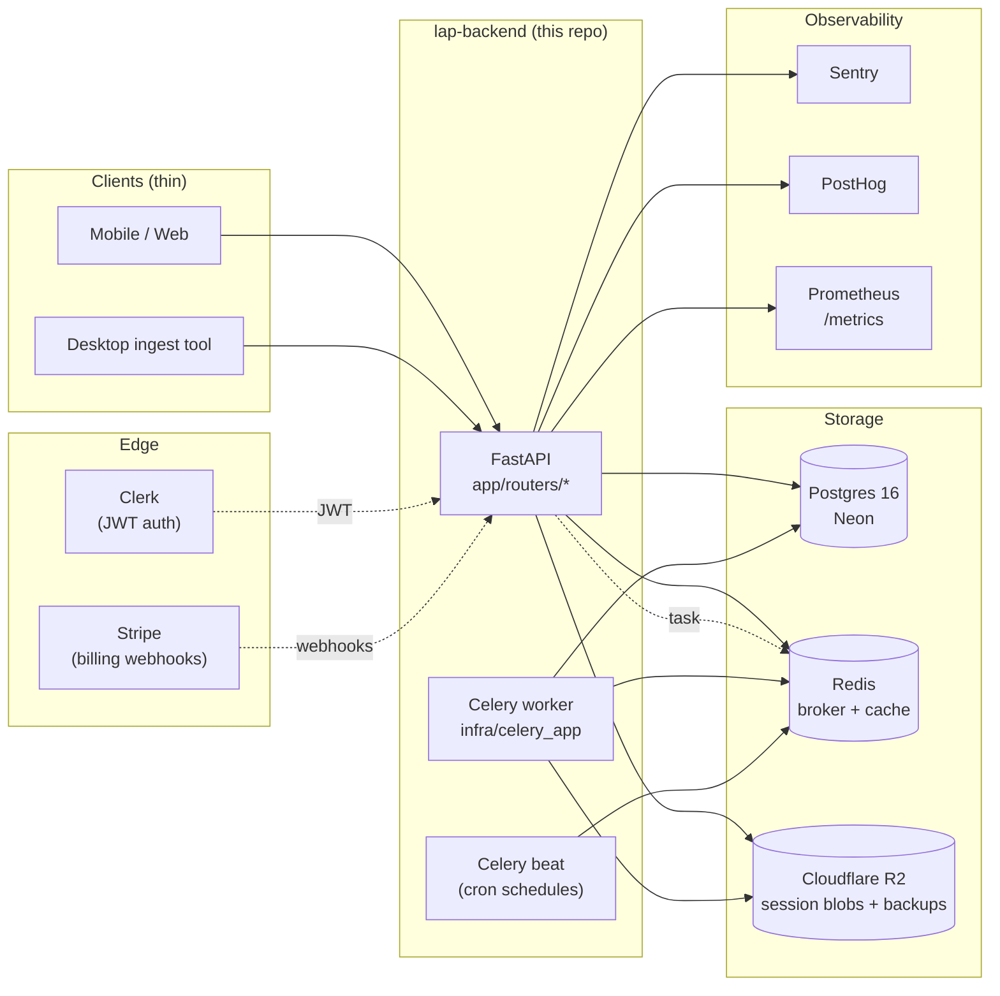

# lap-backend

FastAPI + Celery + Postgres backend for **LAP (Driver OS)** — the
server-side brain that ingests racing telemetry sessions, runs
coaching rules + ML insights, and tracks weakness episodes +
prescriptions across a driver's training.

Doctrine: server owns the brain, clients stay thin.

---

## Quickstart

Prerequisite: [uv](https://docs.astral.sh/uv/) (Python 3.12 toolchain).

```bash
# clone + install
git clone <this repo>
cd lap-backend
uv sync --all-groups

# run db migrations against a local Postgres
export DATABASE_URL=postgresql+asyncpg://localhost/lap
uv run alembic upgrade head

# start the API (auto-reload on file changes)
uv run uvicorn app.main:app --reload
# OR via Makefile:
make dev
```

OpenAPI explorer at http://localhost:8000/api/v1/docs once the API is up.

### Run the worker (for session ingest pipeline)

```bash
# in a second terminal
export REDIS_URL=redis://localhost:6379/0
uv run celery -A infra.celery_app:celery_app worker -l info

# in a third terminal (for cron-like beat schedules)
uv run celery -A infra.celery_app:celery_app beat -l info
```

### Tests

```bash
uv run pytest -q       # unit + integration
make test              # same, via Makefile
make lint              # ruff + mypy strict
```

The CI pipeline (`.github/workflows/ci.yml`) runs the same
commands plus `bandit` + `pip-audit` security scans (T234).

---

## Project layout

```
app/          FastAPI surface — routers, middleware, deps, config
  routers/    one module per concern (sessions, coaching, billing, …)
    v2/      scaffold for the next major version (T238)
  flags.py    env-backed feature flags for gradual rollouts
domain/       pure business logic (no I/O, no framework imports)
infra/        side-effects: DB models, Celery, R2, external HTTP
coaching/     rules engine + YAML rule library
alembic/      DB migrations (one per schema-changing PR)
scripts/      operator CLIs (db restore, k6 load tests, …)
tests/        pytest test suite — mirrors source layout
docs/         backend-local docs (error budget, onboarding extras)
```

Conventions enforced in `CLAUDE.md`:
- every public function typed with strict mypy
- every endpoint has a Pydantic request + response model + a test
- every new DB column has an Alembic migration
- no business logic in routers, no raw SQL outside `infra/`

---

## Architecture

Authoritative reference: [`docs/roadmap/02-ARCHITECTURE-DECISIONS.md`](../docs/roadmap/02-ARCHITECTURE-DECISIONS.md)
(parent repo). Key ADRs:

- **ADR-001** — FastAPI over Flask
- **ADR-003** — UUIDv7 for all IDs
- **ADR-005** — 7 canonical domain objects
- **ADR-009** — Server-authored coaching rules, client-executed
- **ADR-011** — Clerk for auth
- **ADR-012** — Unified `/api/v1/sessions/ingest` endpoint
- **ADR-013** — YAML coaching library format



---

## Deployment

The backend deploys as two long-running containers behind a
load balancer (the API) and a worker pool (Celery + beat). Env
vars are the contract — see `app/config.py` for the canonical
list. Required at boot:

| Env var | Purpose |
|---|---|
| `DATABASE_URL` | Postgres connection (asyncpg DSN) |
| `REDIS_URL` | Celery broker + result backend |
| `CLERK_SECRET` | JWT signing-key fetch authentication |
| `CLERK_ISSUER` | Expected JWT issuer URL |
| `STRIPE_SECRET` | Stripe API key |
| `R2_BACKUP_BUCKET` + `R2_ACCESS_KEY_ID` + `R2_SECRET_ACCESS_KEY` + `R2_ENDPOINT_URL` | Session blob + DB backup storage |
| `COACHING_BUNDLE_SIGNING_SECRET` | HMAC for signed rules bundle (T204) |

Optional (default-off): `SENTRY_DSN`, `POSTHOG_PROJECT_API_KEY`,
plus `FLAG_<NAME>` env vars for the feature-flag system (T237).

### Operations

- **Backups**: Daily 02:00 UTC pg_dump → R2 (Celery beat task,
  T235). Restore with `python scripts/restore_db.py --key <K> --target <URL>` (T236).
- **Error budget & SLOs**: [`docs/error-budget.md`](docs/error-budget.md).
- **Load tests**: [`scripts/k6/`](scripts/k6/) — `sessions_ingest.js`
  (50 rps, p95 <500ms, T230), `driver_profile.js` (500 rps,
  p95 <200ms, T231).

---

## Sprint queue & changelog

- 30-day backend sprint: [`../docs/roadmap/sprint-30day/sprint-backend.md`](../docs/roadmap/sprint-30day/sprint-backend.md)
- Released changes: [`CHANGELOG.md`](CHANGELOG.md) (Keep a Changelog 1.1)
